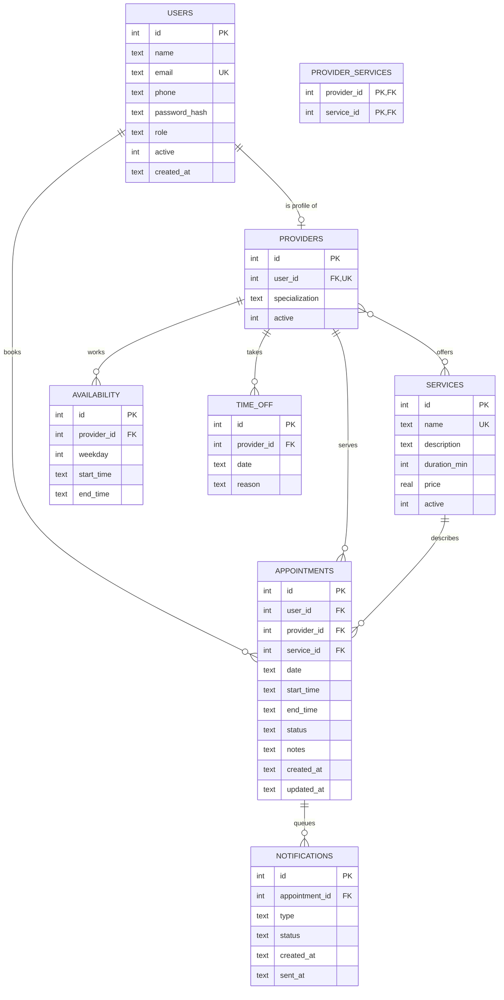

# Database design

One SQLite file, created from `schema.sql` by `db.init_db()`. Foreign keys are
enabled on every connection in `db.connect()`, because SQLite disables them by
default.

## Entities

### `users`

Every person who can sign in, whatever their role.

| Column | Type | Constraints | Meaning |
|---|---|---|---|
| `id` | INTEGER | PK, autoincrement | Surrogate key. |
| `name` | TEXT | NOT NULL | Display name. |
| `email` | TEXT | NOT NULL, UNIQUE | Login identifier, stored lowercased. |
| `phone` | TEXT | nullable | Contact number. |
| `password_hash` | TEXT | NOT NULL | Salted hash; the raw password is never stored. |
| `role` | TEXT | NOT NULL, CHECK in (`customer`, `provider`, `admin`) | Decides which endpoints apply. |
| `active` | INTEGER | NOT NULL, CHECK in (0, 1) | Deactivated accounts cannot log in. |
| `created_at` | TEXT | NOT NULL | UTC ISO-8601 string. |

### `services`

The catalogue the customer chooses from.

| Column | Type | Constraints | Meaning |
|---|---|---|---|
| `id` | INTEGER | PK | Surrogate key. |
| `name` | TEXT | NOT NULL, UNIQUE | Shown on the booking page. |
| `description` | TEXT | nullable | One-line explanation. |
| `duration_min` | INTEGER | NOT NULL, CHECK > 0 | Length of one appointment. |
| `price` | REAL | NOT NULL, CHECK >= 0 | Currency amount used by reports. |
| `active` | INTEGER | NOT NULL, CHECK in (0, 1) | Inactive services disappear from public lists. |

`duration_min` must also be a multiple of `SLOT_STEP_MIN`; that rule needs
configuration, so it lives in `routes/services.py` rather than in the schema.

### `providers`

Staff who take appointments. A provider is always backed by a `users` row with
`role = 'provider'`.

| Column | Type | Constraints | Meaning |
|---|---|---|---|
| `id` | INTEGER | PK | Surrogate key. |
| `user_id` | INTEGER | NOT NULL, UNIQUE, FK → `users.id` | Login account, one per provider. |
| `specialization` | TEXT | nullable | Free text such as "Hair Stylist". |
| `active` | INTEGER | NOT NULL, CHECK in (0, 1) | Inactive providers cannot be booked. |

`UNIQUE(user_id)` is what makes the account-to-profile link one-to-one.

### `provider_services`

Which provider offers which service. A pure join table, because the
relationship is many-to-many.

| Column | Type | Constraints | Meaning |
|---|---|---|---|
| `provider_id` | INTEGER | PK part, FK → `providers.id` | |
| `service_id` | INTEGER | PK part, FK → `services.id` | |

The composite primary key prevents duplicate links.

### `availability`

Recurring weekly working hours.

| Column | Type | Constraints | Meaning |
|---|---|---|---|
| `id` | INTEGER | PK | |
| `provider_id` | INTEGER | NOT NULL, FK → `providers.id` | |
| `weekday` | INTEGER | NOT NULL, CHECK 0–6 | 0 = Monday, matching `date.weekday()`. |
| `start_time` | TEXT | NOT NULL | `HH:MM`, 24-hour. |
| `end_time` | TEXT | NOT NULL | `HH:MM`, greater than `start_time`. |

Several rows per weekday are allowed, which is how a lunch break is
represented. Overlaps between rows are rejected in the route, not by the
schema, because the rule spans several rows.

### `time_off`

Whole days the provider does not work.

| Column | Type | Constraints | Meaning |
|---|---|---|---|
| `id` | INTEGER | PK | |
| `provider_id` | INTEGER | NOT NULL, FK → `providers.id` | |
| `date` | TEXT | NOT NULL | `YYYY-MM-DD`. |
| `reason` | TEXT | nullable | Shown to staff only. |

`UNIQUE(provider_id, date)` means at most one entry per provider per day.

### `appointments`

One booking.

| Column | Type | Constraints | Meaning |
|---|---|---|---|
| `id` | INTEGER | PK | |
| `user_id` | INTEGER | NOT NULL, FK → `users.id` | The customer. |
| `provider_id` | INTEGER | NOT NULL, FK → `providers.id` | Who will see them. |
| `service_id` | INTEGER | NOT NULL, FK → `services.id` | What was booked. |
| `date` | TEXT | NOT NULL | Local `YYYY-MM-DD`. |
| `start_time` | TEXT | NOT NULL | Local `HH:MM`. |
| `end_time` | TEXT | NOT NULL | `start_time` plus the service duration. |
| `status` | TEXT | NOT NULL, CHECK in (`booked`, `completed`, `cancelled`, `no_show`) | Lifecycle state. |
| `notes` | TEXT | nullable | Customer note for the provider. |
| `created_at` | TEXT | NOT NULL | UTC audit timestamp. |
| `updated_at` | TEXT | NOT NULL | UTC audit timestamp. |

Dates and times are local wall-clock values, because the business works in
the server's time zone. Only audit timestamps are UTC.

### `notifications`

The outbox. Rows are queued by booking, cancellation and reschedule, and by
the reminder job; a separate worker sends them.

| Column | Type | Constraints | Meaning |
|---|---|---|---|
| `id` | INTEGER | PK | |
| `appointment_id` | INTEGER | NOT NULL, FK → `appointments.id` | |
| `type` | TEXT | NOT NULL, CHECK in (`confirmation`, `reminder`, `cancellation`, `reschedule`) | Subject and body vary by type. |
| `status` | TEXT | NOT NULL, CHECK in (`pending`, `sent`, `failed`) | Queue state. |
| `created_at` | TEXT | NOT NULL | |
| `sent_at` | TEXT | nullable | Set only on success. |

## Relationships

| Relationship | Cardinality | Implementation |
|---|---|---|
| `users` → `providers` | one to zero-or-one | `providers.user_id` is `UNIQUE` and a foreign key. |
| `providers` ↔ `services` | many to many | `provider_services` join table. |
| `providers` → `availability` | one to many | `availability.provider_id`. |
| `providers` → `time_off` | one to many | `time_off.provider_id`, unique per date. |
| `users` → `appointments` | one to many | `appointments.user_id` (customers only in practice). |
| `providers` → `appointments` | one to many | `appointments.provider_id`. |
| `services` → `appointments` | one to many | `appointments.service_id`. |
| `appointments` → `notifications` | one to many | `notifications.appointment_id`. |

Every foreign key uses `ON DELETE RESTRICT`. Nothing is deleted by the
application, so the database refuses to remove a user, provider or service
that history still refers to. This is why services and providers are
deactivated rather than deleted.

## Diagram



Plain-text version, for a report that cannot render Mermaid:

```
users 1 --- 0..1 providers --- 0..N availability
  |                 |  \
  |                 |   \--- 0..N time_off
  |                 |
  |                 +--- N..M services  (via provider_services)
  |
  +--- 0..N appointments --- 0..N notifications
                 |
                 +--- N..1 services
                 +--- N..1 providers
```

## Indexes and why they exist

| Index | Purpose |
|---|---|
| `idx_availability_provider_weekday` | Slot generation looks up one provider's hours for one weekday. |
| `idx_appointments_user` | Customer listing filters `user_id` and sorts by `date`. |
| `idx_appointments_provider` | Provider listing and overlap checks filter `provider_id` and `date`. |
| `idx_appointments_unique_booked` | **Partial** unique index on `(provider_id, date, start_time)` where `status = 'booked'`. This is the last line of defence against double booking; cancelling frees the slot because cancelled rows are outside the index. |
| `idx_notifications_appointment` | The worker joins notifications to their appointment. |
| `idx_notifications_one_reminder` | Partial unique index on `appointment_id` where `type = 'reminder'`, so two worker runs cannot queue two reminders. |

## Data volume notes

A booking joins four tables (appointments, users, providers, users again,
services). With the indexes above, a month of appointments for one clinic is
a few thousand rows, well inside SQLite's comfort zone. Reports are capped at
366 days for the same reason.

## Why this shape

- **One `users` table, not three.** Login, hashing and deactivation are
  identical for every role, so duplicating them would multiply bugs. The
  `providers` table then holds only what is specific to a provider.
- **Amounts on `services`, not on `appointments`.** The price is a property of
  what was sold. The trade-off is that changing a price rewrites history in
  reports; a price snapshot column on `appointments` would fix that if needed.
- **Status as text with a CHECK.** It reads directly in the database and in
  JSON, and SQLite still refuses an invalid value.
- **`time_off` separate from `availability`.** Weekly hours are a pattern; a
  day off is an exception to that pattern. Mixing them would mean rewriting
  the pattern for every holiday.
