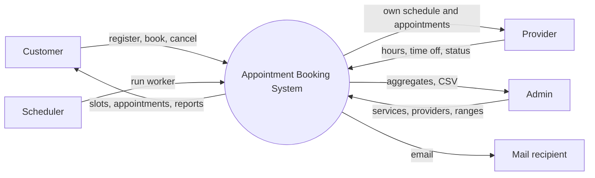
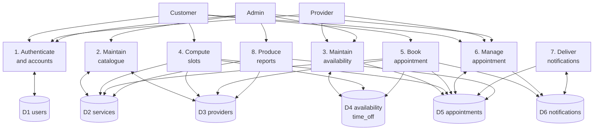

# Data flow diagrams

Two views of the same system: who talks to it, and what happens inside.

## Level 0 — context diagram

The system has exactly one interface: HTTP. Browsers talk JSON to it, and a
separate worker process reads the outbox and sends email.

```
                +-----------------------------------+
                |                                   |
   Customer --->|                                   |---> Email recipient
   (browser)    |      Appointment Booking System   |     (SMTP or console)
                |                                   |
   Provider --->|                                   |
   (browser)    |                                   |
                |                                   |
      Admin --->|                                   |
   (browser)    |                                   |
                +-----------------------------------+
```

| External entity | Sends in | Receives out |
|---|---|---|
| Customer | Registration, booking requests, cancellation and reschedule requests | Slot lists, appointment records, status messages, confirmation and reminder email |
| Provider | Availability edits, time-off entries, status changes | Their own appointment list, their weekly hours, conflict warnings |
| Admin | Service and provider records, report ranges | Catalogue views, provider directory, aggregates and CSV exports |
| Mail recipient | — | Confirmation, reminder, reschedule and cancellation messages |
| Scheduler (optional) | A trigger to run the notification worker | A one-line summary of queued, sent and failed messages |



## Level 1 — main processes

| # | Process | Input | Output | Data stores touched |
|---|---|---|---|---|
| 1 | Authenticate and manage accounts | Credentials, registration data | Session cookie, user record | D1 |
| 2 | Maintain catalogue | Service and provider details, service assignment | Validated records | D1, D2, D3 |
| 3 | Maintain availability | Weekly windows, days off | Accepted schedule or a conflict list | D3, D4, D5 |
| 4 | Compute available slots | Provider, service, date | List of start times | D2, D3, D4, D5 |
| 5 | Book appointment | Provider, service, date, start time | Appointment or an error | D1, D2, D3, D4, D5, D6 |
| 6 | Manage appointment | Cancel, reschedule, status change | Updated appointment | D5, D6 |
| 7 | Deliver notifications | Queued rows, clock | Sent or failed rows | D5, D6 |
| 8 | Produce reports | Date range, filters | Totals, breakdowns, CSV | D2, D3, D5 |

### Data stores

| Id | Store | Table(s) |
|---|---|---|
| D1 | Accounts | `users` |
| D2 | Catalogue | `services`, `provider_services` |
| D3 | Providers | `providers` |
| D4 | Schedule | `availability`, `time_off` |
| D5 | Appointments | `appointments` |
| D6 | Outbox | `notifications` |

## Diagram



Plain-text version of the booking path, which is the one worth showing in
detail:

```
Customer
   |  service_id, provider_id, date
   v
+------------------------------+
| 4. Compute available slots   |<--- D4 schedule (windows, time off)
|                              |<--- D5 appointments (booked rows)
|                              |<--- D2 duration and active flag
|                              |<--- D3 provider active flag
+------------------------------+
   |  slots: ["09:00", "09:30", ...]
   v
Customer picks a start time
   |
   v
+------------------------------+
| 5. Book appointment          |
|  a. validate shape (400)     |
|  b. re-check every rule      |
|  c. BEGIN IMMEDIATE          |
|  d. insert + queue mail      |
|  e. COMMIT                   |
+------------------------------+
   |            \
   |             \--> D6 notifications (pending)
   v
D5 appointments (booked)
   |
   v
Appointment JSON + 201
```

## Trust boundaries

- **Browser → API.** Everything from the browser is untrusted: ids, dates,
  notes, the claimed role. Each route re-reads the user from the database and
  re-validates every field.
- **API → database.** Parameterised queries only; identifiers are integers
  validated before they reach a placeholder.
- **Worker → mail server.** Failure is contained: a failed message is marked
  `failed` and never blocks a booking.

## What is deliberately absent

The classic DFD has no store for "available slots". Slots are computed on
demand from D4 and D5, so there is nothing to keep in sync and no stale cache
to invalidate.
